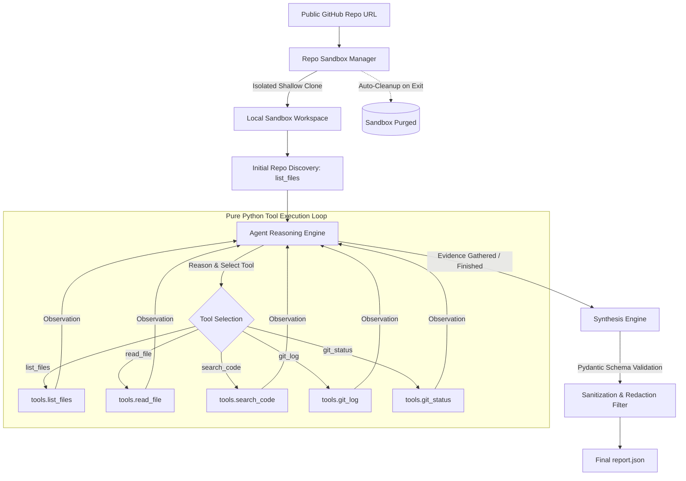

# DevOps Repository Auditing Agent

[](https://www.python.org/downloads/)
[](#architecture)
[](LICENSE)
[](#testing)


An autonomous AI-powered DevOps & DevSecOps auditing agent that inspects GitHub repositories, identifies best-practice violations across 9 critical DevOps disciplines, gathers verifiable evidence using inspection tools, and generates structured, machine-readable audit reports.

Built from first principles in **pure Python** (without LangChain, LangGraph, or high-level orchestration abstractions) utilizing direct LLM tool calling protocols with **Google Gemini**.

---

## Architecture & Agent Cycle

The agent strictly implements the cyclic reasoning loop:
$$\text{Observe} \longrightarrow \text{Reason} \longrightarrow \text{Select Tool} \longrightarrow \text{Execute Tool} \longrightarrow \text{Interpret Results} \longrightarrow \text{Report}$$



### Why Zero-Framework Architecture?
Unlike pre-packaged agent frameworks that obscure tool dispatch and state changes behind abstractions, this agent implements:
* **Native Tool Protocol**: Function calling contracts defined and dispatched natively in Python.
* **Deterministic Execution Control**: Bounded iteration limits, cycle break triggers, and sandboxed file handling.
* **Granular Observability**: Every tool call, intermediate observation, and token trace is logged with structured formatting.

---

## DevOps Inspection Disciplines

The agent performs deep investigations across 9 core engineering areas:

| Category | Example Violations Covered |
| :--- | :--- |
| **Repository Hygiene** | Missing/empty README, absent/unsuitable `.gitignore`, tracked build/generated artifacts (`__pycache__`, `.DS_Store`, `node_modules`). |
| **Dependency Management** | Wildcard / unpinned version specifications, missing required lockfiles (`poetry.lock`, `Pipfile.lock`), dependency confusion risks. |
| **Code Quality** | Missing linting/formatting configuration (`ruff`, `black`, `flake8`, `eslint`), maintainability anti-patterns. |
| **Testing** | Complete absence of test suites, failing/skipped tests, tests excluded from automated CI execution. |
| **GitHub Actions / CI** | Dangerous triggers (`pull_request_target` with head checkout), excessive default permissions (missing `permissions: read-all`), unpinned 3rd-party actions (`@master` instead of SHA), missing build gates. |
| **Security** | Hardcoded credentials, API keys, database passwords, private certificates in code or Git commit history, exposed `.env` files. |
| **Configuration** | Machine-specific absolute paths hardcoded (`/home/...`, `C:\...`), lack of environment variable separation for local vs prod settings. |
| **Collaboration** | Missing `CODEOWNERS`, insecure PR automation, absent security policy (`SECURITY.md`). |
| **Build & Release** | Missing automated build validation, unverified releases, deployment workflows lacking preceding test gates. |

### Evidence & Anti-Hallucination Guardrails
1. **The Evidence Rule:** An absent optional file is **never** flagged as a violation if an acceptable equivalent exists (e.g., configuration inside `pyproject.toml` instead of individual dotfiles, or a `Makefile` instead of `tox`).
2. **Branch Protection:** The agent never hallucinates remote branch protection settings from local repository files alone.
3. **Secret Redaction:** Raw credential values are **never** reproduced in logs or reports. All secrets are automatically masked (e.g. `***[REDACTED_SECRET]***`) by the `SecretScrubbingFilter`.

---

## Project Structure

```
.
├── agent.py                 # CLI entry point (implements required execution interface)

├── tools.py                 # Sandboxed inspection tools (list_files, read_file, search_code, git_log, git_status, inspect_github_actions)
├── agent_core/
│   ├── __init__.py
│   ├── loop.py              # Pure Python agent loop (Observe -> Reason -> Dispatch -> Report)
│   ├── llm_client.py        # Gemini client initialization and tool declarations
│   ├── repo_manager.py      # Sandboxed Git cloning, URL injection defense, and cleanup
│   ├── logger.py            # Enterprise structured logging + secret redaction filter
│   ├── schema.py            # Pydantic schema for output contract compliance
│   ├── prompts.py           # Domain guidelines, 9-category rubric, and JSON constraints
│   └── utils.py             # Security utilities including safe_path_join traversal defense
├── tests/
│   ├── test_agent_e2e.py    # End-to-end integration tests for loop and CLI flags
│   ├── test_agent_loop.py   # Unit tests for tool registry and callable dispatch
│   ├── test_logger.py       # Security tests for secret scrubbing filter
│   ├── test_repo_manager.py # Tests for URL injection defenses and sandbox paths
│   ├── test_schema.py       # Pydantic schema validation tests
│   ├── test_tools.py        # Comprehensive tests for all inspection tools and aliases
│   └── test_utils.py        # Unit tests for safe_path_join and path validation
├── sample_report.json       # Authentic example agent output
├── requirements.txt         # Minimal, pinned dependencies
├── .env.example             # Configuration template
├── .gitignore               # DevOps best-practice exclusions
└── README.md                # System documentation
```

---

## Installation & Setup

### 1. Prerequisites
* Python 3.10+ (tested on Python 3.12)
* Git installed and available on system `PATH`
* Google Gemini API Key ([Google AI Studio](https://aistudio.google.com/))

### 2. Clone and Setup Environment
```bash
# Clone the repository
git clone <your-repo-url>
cd <repo-folder>

# Create and activate a virtual environment
python -m venv .venv

# On Linux/macOS:
source .venv/bin/activate
# On Windows:
.venv\Scripts\activate

# Install dependencies
pip install -r requirements.txt
```

### 3. Configure API Credentials
Copy the `.env.example` file to `.env`:
```bash
cp .env.example .env
```
Edit `.env` and insert your Gemini API Key:
```ini
GEMINI_API_KEY=your_actual_gemini_api_key_here
GEMINI_MODEL=gemini-2.5-flash
LOG_LEVEL=INFO
MAX_ITERATIONS=15
```

---

## Execution Interface

The agent runs unattended without interactive prompts. In accordance with the execution contract:

```bash
python agent.py --repo <github_repository_url> --output report.json
```

### Options:
* `--repo`: Target public GitHub repository URL (e.g. `https://github.com/owner/repository`). *(Required)*
* `--output`: Output JSON destination path (default: `report.json`). *(Optional)*
* `--max-iterations`: Maximum reasoning loop turns (default: `15`). *(Optional)*
* `--model`: Override Gemini model (default: `gemini-2.5-flash`). *(Optional)*

### Exit Codes:
* `0`: Audit completed successfully (report written to disk, including empty violations array if clean).
* `1`: Fatal error (invalid URL, cloning failure, missing credentials).

---

## Output Contract & Report Format

The agent produces strictly compliant, machine-readable JSON matching the specification:

```json
{
  "repository": "https://github.com/example/demo-project",
  "violations": [
    {
      "rule_id": "SEC-001",
      "category": "security",
      "severity": "critical",
      "file": "config/database.py",
      "line": 14,
      "description": "Hardcoded database credential in source code",
      "evidence": "DB_PASSWORD = '***[REDACTED_SECRET]***'",
      "recommendation": "Migrate database credentials to environment variables or a secret management vault."
    }
  ]
}
```

* **Severity Levels:** Strictly `critical`, `high`, `medium`, or `low`.
* **Null Handling:** Repository-wide findings (e.g., missing CI workflow or absent `.gitignore`) properly set `file` and `line` to `null`.
* **Zero Credential Exposure:** Secret keys and passwords are masked with redaction placeholders.

---

## Testing & Quality Assurance

A comprehensive automated test suite validates tool security, URL sanitization, secret scrubbing, schema validation, and agent loop dispatch:

```bash
# Run the entire test suite
pytest -v

# Run with test coverage
pytest --cov=agent_core --cov=tools
```

### Test Coverage Highlights:
* `test_logger.py`: Asserts that GitHub tokens, AWS keys, and password patterns are intercepted and scrubbed before writing.
* `test_repo_manager.py`: Validates injection defenses against malicious command-line payloads and non-GitHub URIs.
* `test_tools.py`: Validates path traversal defenses, line-number formatting, regex searching, and binary file protection.
* `test_schema.py`: Verifies Pydantic validation of severity enums and null field handling.
* `test_agent_loop.py`: Validates tool dispatch and report deduplication.

---

## CV & Engineering Portfolio Highlights

This project demonstrates advanced software engineering and MLOps proficiencies:
* **Production AI Engineering:** Custom-built autonomous reasoning loop without reliance on brittle third-party agent wrappers.
* **DevSecOps Automation:** AST/regex pattern matching, Git history inspection, and CI/CD security posture analysis.
* **Defensive Sandboxing:** Safe execution on untrusted public codebases with automated workspace isolation and cleanup.
* **Deterministic Structured Output:** Schema enforcement through native Pydantic models and Gemini structured outputs.
